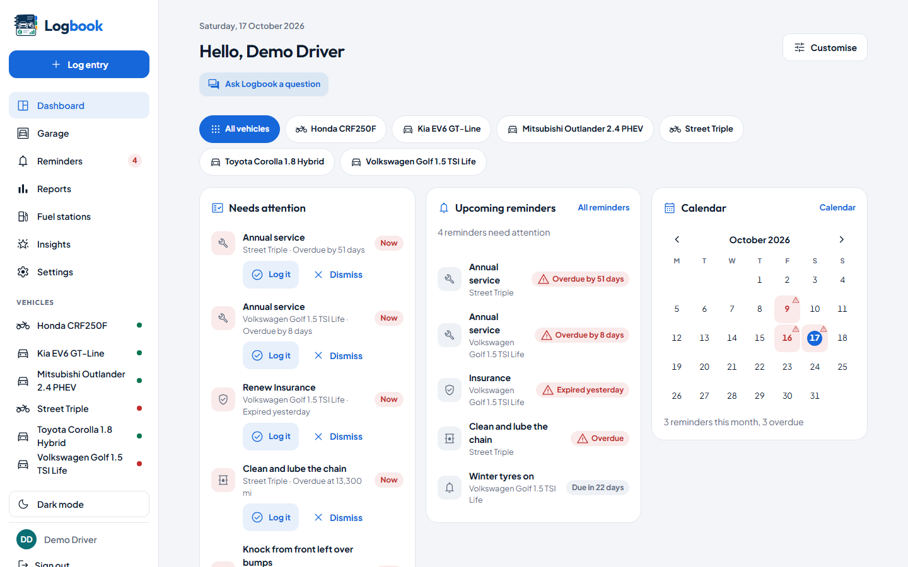
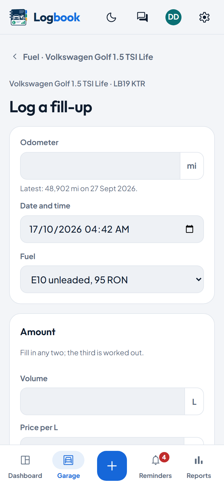
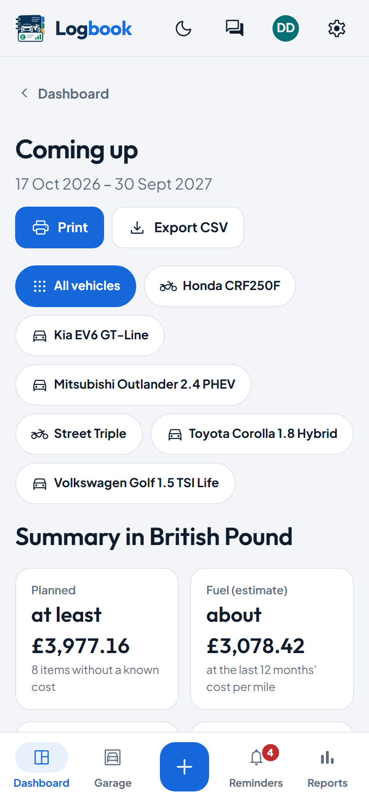
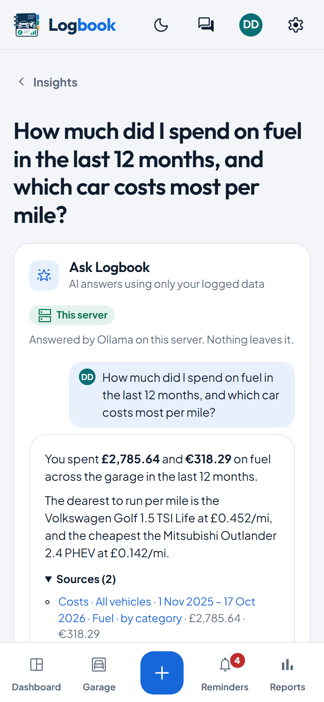

# Logbook

A self-hosted logbook for your cars and bikes: fuel, mileage, servicing,
renewals, reminders and what it all costs, on your own server.

[](CHANGELOG.md)
[](LICENSE)
[](https://github.com/gwpreston16/Logbook/actions/workflows/ci.yml)

**Status: v3.16.4.** What changed in each release is in [`CHANGELOG.md`](CHANGELOG.md).

## Who it's for

Logbook is for people who self-host and look after a household's cars and
bikes, one vehicle or several. It keeps every record on your own server,
and it does more than a fuel app: servicing, tyres, insurance and MOT
renewals, reminders, the true cost per mile, and the whole history when you
sell. Each person in the household gets their own account, and a vehicle
can be shared with them.

It isn't for fleet operators with drivers and cost centres, or for anyone
who wants a hosted service.

## Screenshots

<picture>
  <source media="(prefers-color-scheme: dark)" srcset="docs/images/dashboard-desktop-dark.png">
  
</picture>

<table>
  <tr>
    <td width="33%"><picture><source media="(prefers-color-scheme: dark)" srcset="docs/images/add-fill-up-phone-dark.png"></picture></td>
    <td width="33%"><picture><source media="(prefers-color-scheme: dark)" srcset="docs/images/coming-up-phone-dark.png"></picture></td>
    <td width="33%"><picture><source media="(prefers-color-scheme: dark)" srcset="docs/images/ask-phone-dark.png"></picture></td>
  </tr>
</table>

More in [`docs/features.md`](docs/features.md).

## Quick start

**Docker with PostgreSQL** (no edits needed):

```bash
git clone https://github.com/gwpreston16/Logbook.git && cd Logbook
docker compose up -d                      # → http://localhost:8080
```

MySQL instead: `docker compose -f docker-compose.mysql.yml up -d`.

**One container with SQLite** (from the cloned repository):

```bash
docker build -t logbook .
docker run -d --name logbook -p 8080:80 -v logbook_data:/data logbook
```

**Plain PHP 8.4** (web root = `public/`, with `intl`, `sodium`, `gd` and `exif`):

```bash
composer install --no-dev -o
cp .env.example .env                      # set DB_* and APP_URL
vendor/bin/phinx migrate -e production
```

Then point Apache or nginx at `public/` and add the scheduler to cron, as
[docs/deployment.md](docs/deployment.md#bare-php-84) shows.

However you install it, the first run is the same:

1. Open the address in a browser.
2. Create the first admin account.
3. Add your first vehicle; Logbook offers to set up its mileage, MOT, tax
   and insurance dates and a servicing interval as it goes.
4. Log a fill-up with **Log entry** (or the **+** on a phone).

[Getting started](docs/getting-started.md) walks through the rest: email,
inviting the household, switching off what you don't use, and the first
backup. Reverse proxies, subpaths, the phone app and upgrades are in
[docs/deployment.md](docs/deployment.md).

## Features

1. **[Garage, people and sharing](docs/features.md#1-garage-people-and-sharing):** cars and bikes of every fuel, the household on one install, vehicles shared at the level you choose.
2. **[Fuel, charging and economy](docs/features.md#2-fuel-charging-and-economy):** full-to-full economy in your units, grades compared, fuel stations and live UK prices.
3. **[Maintenance, tyres, parts and issues](docs/features.md#3-maintenance-tyres-parts-and-issues):** service schedules that work out what's next, tyre wear, modifications and faults you're watching.
4. **[Documents, renewals and MOT history](docs/features.md#4-documents-renewals-and-mot-history):** insurance, MOT and tax with their expiry, receipts attached, a UK car's MOT history from DVSA.
5. **[Costs, reports and finance](docs/features.md#5-costs-reports-and-finance):** reports with CSV and print, the true cost per mile, depreciation, finance agreements, mileage claims and a sale pack.
6. **[Incidents and claims](docs/features.md#6-incidents-and-claims):** damage and claims with their repairs, and a claims history for quotes.
7. **[Reminders and notifications](docs/features.md#7-reminders-and-notifications):** reminders by email, ntfy, Telegram and more; *Coming up* and *Needs attention*.
8. **[AI, the API and MCP](docs/features.md#8-ai-the-api-and-mcp):** optional AI with the model you choose, *Ask Logbook*, a REST API with webhooks, and an MCP server.
9. **[Import, backup and the phone app](docs/features.md#9-import-backup-and-the-phone-app):** CSV, Fuelio and Tracktor imports, one-click backups, and an installable app that works offline.

In English and German.

## Documentation

- **Install and run:** [deployment](docs/deployment.md), [configuration](docs/configuration.md), [reverse proxies](docs/reverse-proxies.md), [Proxmox](docs/proxmox-lxc.md).
- **Use:** [getting started](docs/getting-started.md), [features](docs/features.md), and a guide per feature.
- **Integrate:** [REST API](docs/api.md), [MCP server](docs/mcp.md), [AI](docs/ai.md), [single sign-on](docs/sso.md).
- **Contribute:** [CONTRIBUTING.md](CONTRIBUTING.md), [translations](docs/translations.md).

Every guide is listed in the [docs index](docs/README.md).

## Configuration

Everything is an environment variable (or a line in `.env`), with defaults
that work unedited. The full list is in [`.env.example`](.env.example) and
[docs/configuration.md](docs/configuration.md); the email server is set up
in the app, in Settings → Delivery.

## Upgrading

Pull the new image (or code) and restart; migrations run on start.
[docs/deployment.md](docs/deployment.md#upgrading) has the steps for each
install, and [`CHANGELOG.md`](CHANGELOG.md) any upgrade notes. Coming from
2.x, read the [3.0.0 notes](CHANGELOG.md#300--2026-10-05) first; coming from
3.2, email is off until an admin sets it up in Settings → Delivery (the
[3.3.0 notes](CHANGELOG.md#330--2026-10-07)). The plan is in
[`ROADMAP.md`](ROADMAP.md).

## Licence

Copyright (C) 2026 Gareth Preston.

Logbook is free software: you can redistribute it and/or modify it under the
terms of the GNU Affero General Public License as published by the Free
Software Foundation, either version 3 of the License, or (at your option) any
later version. It is distributed in the hope that it will be useful, but
WITHOUT ANY WARRANTY; without even the implied warranty of MERCHANTABILITY or
FITNESS FOR A PARTICULAR PURPOSE. See [LICENSE](LICENSE) for the full text.

In short: you may run, study, change and share it. If you run a changed copy
for other people to use over a network, you must offer them its source.

This licence covers every published version of Logbook, including releases
tagged before the `LICENSE` file was added. The third-party code, fonts and
icons it bundles keep their own licences: see
[THIRD-PARTY-NOTICES.md](THIRD-PARTY-NOTICES.md).

## Contributing

Bug reports and ideas are welcome as issues. Code contributions are accepted
under the project licence, with every commit signed off (`git commit -s`).
Development setup, tests and the release steps are in
[CONTRIBUTING.md](CONTRIBUTING.md).
