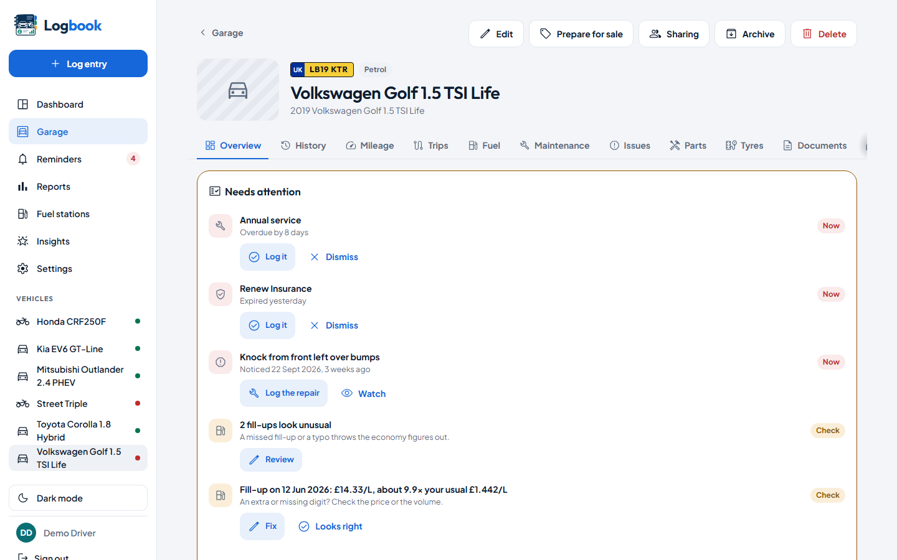
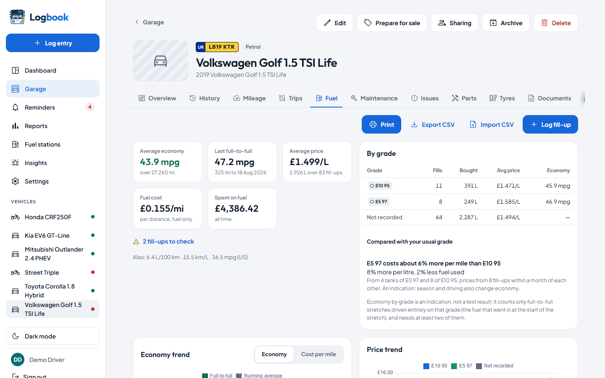
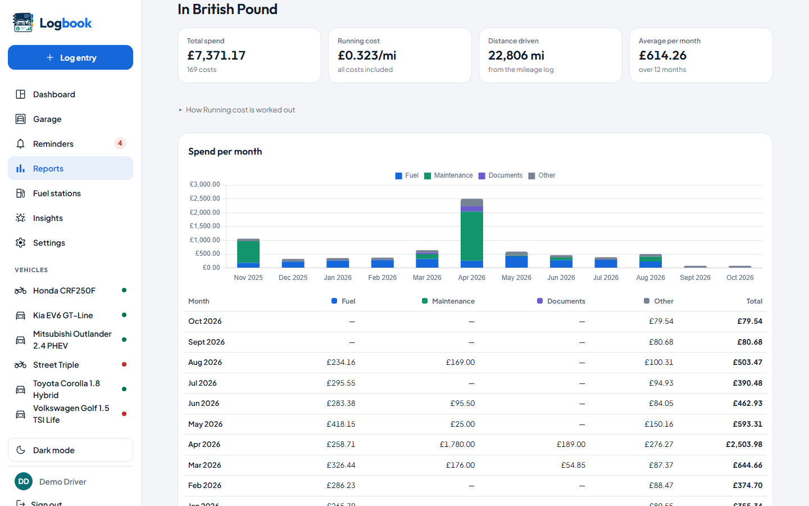
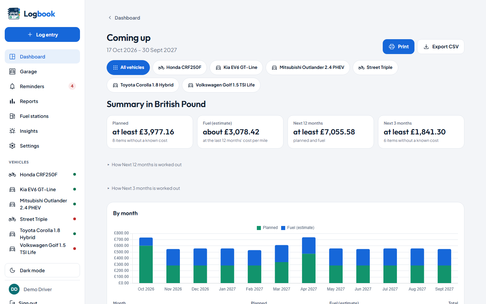
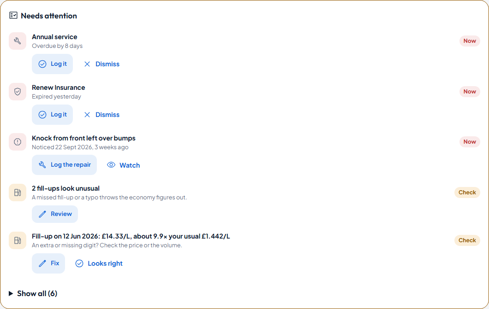
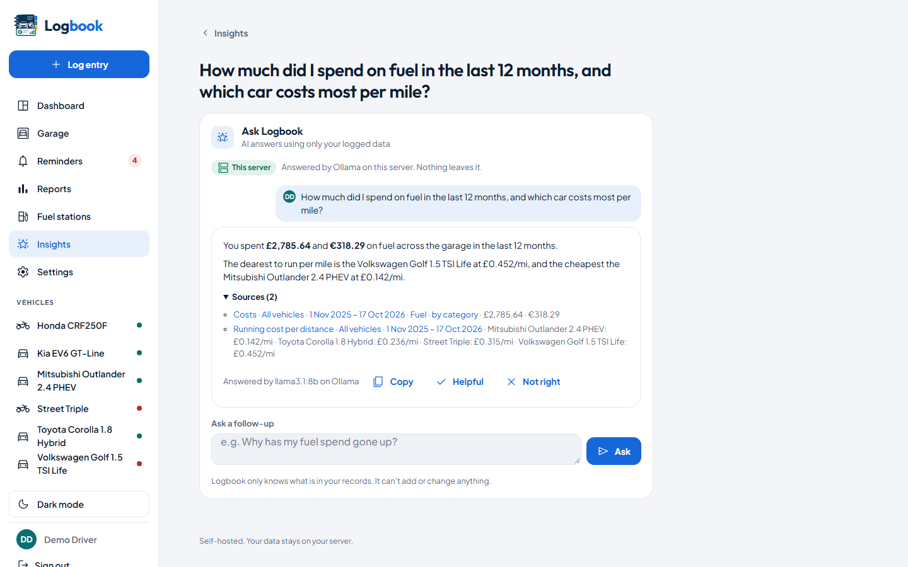

# Features

Everything Logbook does, in the nine groups the [README](../README.md#features)
uses, each linking to the guide that explains it.

**For:** anyone deciding whether Logbook does what they need, or looking for
the guide to a feature.

- [1. Garage, people and sharing](#1-garage-people-and-sharing)
- [2. Fuel, charging and economy](#2-fuel-charging-and-economy)
- [3. Maintenance, tyres, parts and issues](#3-maintenance-tyres-parts-and-issues)
- [4. Documents, renewals and MOT history](#4-documents-renewals-and-mot-history)
- [5. Costs, reports and finance](#5-costs-reports-and-finance)
- [6. Incidents and claims](#6-incidents-and-claims)
- [7. Reminders and notifications](#7-reminders-and-notifications)
- [8. AI, the API and MCP](#8-ai-the-api-and-mcp)
- [9. Import, backup and the phone app](#9-import-backup-and-the-phone-app)

## 1. Garage, people and sharing

<picture>
  <source media="(prefers-color-scheme: dark)" srcset="images/vehicle-desktop-dark.png">
  
</picture>

- **Vehicles** of every kind: petrol, diesel, LPG, CNG, electric,
  self-charging and plug-in hybrids, cars and bikes, with photos, the
  variant, the first registration date (and the age it gives), purchase
  and sale paperwork, and archiving.
- **A guided first vehicle:** mileage now, the MOT, tax and insurance
  dates with their reminders, and a servicing interval, in a few skippable
  steps ([Getting started](getting-started.md)).
- **First-run setup** creates the first admin. Secure sign-in with a
  password or your email address, and a forgotten-password link by email.
- **Single sign-on** through Authelia, Authentik or Keycloak, or the user a
  forward-auth proxy passes on ([sso.md](sso.md)).
- **Several people on one install:** admins invite the others, and each
  vehicle is shared at *View*, *Log* or *Manage*, with costs shared or not.
  Each share says in plain words what it allows, before you press *Add*
  ([users-and-sharing.md](users-and-sharing.md)).
- **Each person's own** reminders, units, currency, language and time
  zone.
- **A History tab** per vehicle and for the fleet, with a printable service
  history that leaves costs off unless asked.
- **A dashboard of widgets** you can rearrange, with a *Household* layout
  for new users.
- **Modules you can switch off:** fuel, maintenance, documents, reminders,
  reports and the rest. New installs start with fewer switched on.
- **In English and German** ([translations.md](translations.md) to add
  another).

## 2. Fuel, charging and economy

<picture>
  <source media="(prefers-color-scheme: dark)" srcset="images/fuel-log-desktop-dark.png">
  
</picture>

- **Fuel and EV charging logs** with full-to-full economy: L/100 km, mpg
  (UK and US), km/L, kWh/100 km, mi/kWh, and kg/100 km and mi/kg for CNG.
- **Checks** that flag a tank far from the usual: a mistyped odometer, or a
  fill-up that wasn't full.
- **Prices and running costs**, and the grade bought (E10 or E5, diesel
  blends, home or rapid charging) compared by price and economy.
- **Fuel insights:** whether a dearer grade is worth it, from fills bought
  close together; cost per mile or km per tank and per charging type; and
  economy by month, to show what winter costs.
- **Fuel stations** as records ([stations.md](stations.md)): what you paid
  at each, per grade, over time; favourites first when you log a fill-up,
  with what you paid there last time; straight-line distances from your
  own private places; and duplicates to merge.
- **Live listed fuel prices** from the UK's Fuel Finder feed, once an admin
  switches it on. They are downloaded to your server, so your location
  never leaves it. With them come *Prices nearby* on the Fuel stations
  page (each against the area's average, with what a tank would save and
  directions), *Cheapest near me* ranked by what the trip really costs,
  *Was it worth it?* after a fill-up, the listed price on the fill-up form,
  and price alerts on favourite stations.

## 3. Maintenance, tyres, parts and issues

- **A categorised service history** with recurring schedules ("every
  10,000 mi or 12 months") that work out when each job is next due.
- **Tyres:** what is fitted and what is stored, how far and how old each
  one is, its tread depth, and when it will need replacing.
- **A mileage log** with plausibility warnings.
- **An issues log** for faults you've noticed and not fixed yet, in your
  own words: open, watched, or fixed by the service record that fixed it.
  Recommended work from an invoice or an MOT is added in one tap, and
  Logbook never guesses a cause ([issues.md](issues.md)).
- **Parts and modifications** ([parts.md](parts.md)): what was fitted and
  what came off, warranties with a reminder before they end, a printable
  list for your insurer, and build spend kept out of every running cost per
  mile.

## 4. Documents, renewals and MOT history

- **Insurance, pollution certificates, registration and inspections** with
  their expiry, and the first MOT before there is a certificate, with a
  *First MOT due* date suggested from the first registration date.
- **Receipts, invoices and certificates** attached to any record.
- **A UK vehicle's MOT history from DVSA**, off until an admin enables it:
  its mileages checked against yours, passes kept as MOT documents,
  advisories as issues, and an outstanding recall flagged
  ([mot-history.md](mot-history.md)).

## 5. Costs, reports and finance

<picture>
  <source media="(prefers-color-scheme: dark)" srcset="images/cost-report-desktop-dark.png">
  
</picture>

- **Every cost rolled up** into per-vehicle and fleet reports: by category,
  per month, per mile or km, over any date range, with CSV export and a
  clean printout (or PDF) of every report, its charts in black and grey
  beside their tables ([reports.md](reports.md)).
- **Valuations, depreciation and the total cost of ownership** since you
  bought each vehicle: running costs plus what it has lost in value, exact
  once it is sold.
- **The true cost per mile or km**, split into fuel, maintenance,
  insurance, tax and MOT, other costs and depreciation, ranked on the
  dashboard and traced year by year with what changed and why, leases and
  finance included.
- **Figures that show their working:** every figure built on an old input
  says how old it is, and every headline figure opens to show its inputs
  and its sum in plain words.
- **Hire purchase, PCP, loan and lease agreements** typed from the
  paperwork ([finance.md](finance.md)): the payments left, what remains to
  pay, a settlement estimate or the lender's quote, the cost of credit
  counted once in your costs, equity, mileage against the allowance with
  the excess charge it is heading for, and ending one by settling, handing
  back or selling with finance owing. Figures, never advice.
- **Business trips and mileage claims**, switched on when you need them
  ([trips.md](trips.md)): private mileage worked out from the odometer,
  HMRC's approved rates for UK users or your own, a printable claim with
  employer payments, and whether the allowance covers what the car costs
  to run.
- **A sale pack** for a buyer ([sale-pack.md](sale-pack.md)): a summary, a
  checkable mileage record, and the paperwork as a ZIP.

## 6. Incidents and claims

- **Incidents, damage and insurance claims** ([incidents.md](incidents.md)),
  with repairs linked so they count once.
- **A five-year claims history** for insurance quotes.
- **Insurer letters read** into the incident (with AI on).
- **A car archived as written off**, with its settlement as the sale.

## 7. Reminders and notifications

<picture>
  <source media="(prefers-color-scheme: dark)" srcset="images/coming-up-desktop-dark.png">
  
</picture>

- **Reminders for all of it**, with lead times you choose, as a list or a
  month calendar, plus a calendar feed.
- **Sent when they come due** by email, ntfy, Gotify, Telegram, Discord,
  Pushover, Mattermost, Slack or a webhook
  ([notification-channels.md](notification-channels.md)). Each person sets
  up their own channels, each with what it receives, a test, and quiet
  hours that hold messages overnight.
- **The email server is set up in the app**, by an admin, in Settings →
  Delivery.
- **An optional monthly digest:** what is due, last month's distance and
  spend against your averages, and insights.
- **Coming up:** the next 12 months of services, renewals, tyres and
  reminders, each at what it cost last time, plus a fuel estimate and a
  *Next 3 months* total.
<picture>
  <source media="(prefers-color-scheme: dark)" srcset="images/needs-attention-desktop-dark.png">
  
</picture>

- **Needs attention**, on each vehicle and the dashboard: what is wrong
  right now (overdue work, readings or fill-ups that look wrong, mileage or
  a valuation gone stale, economy slowly getting worse over the last few
  tanks, a price or a service cost with a digit too many), each with its
  fix and the likely causes Logbook can see, and never a score.

## 8. AI, the API and MCP

<picture>
  <source media="(prefers-color-scheme: dark)" srcset="images/ask-desktop-dark.png">
  
</picture>

- **An Insights page** of patterns worked out from your figures, among them
  what filling at the cheapest station nearby would save a year, and
  economy that has improved.
- **Optional AI with the model you choose**, on this server, your network or
  a cloud provider, off until an admin connects one ([ai.md](ai.md)). With
  it on, the model finds a few more insights each day, without working out
  any figure itself.
- **Ask Logbook**, at the top of the Insights page, answers questions in
  plain words from your own records, through read-only tools, with a
  source and a link for every figure and a check that flags any number
  Logbook didn't provide. Your conversations are kept on the Insights
  page.
- **Entries from a sentence:** it drafts fill-ups, readings, services,
  documents, expenses, tread checks and reminders as cards you check and
  add.
- **Reading files:** a photo or PDF of an invoice, receipt or certificate
  is read into the right form for you to check, with the file attached.
  Photos are always stored without their location data. A text-only
  model can read photos too: OCR on your server reads the text first
  ([reading-files.md](reading-files.md)). With a vision model, OCR checks
  what it read and marks a value it can't find on the page; a fuel
  receipt whose figures don't add up says so; and each connection can
  *send text, not images*, so no photo leaves your server. *Scan the V5C*
  on a vehicle's page offers a registration certificate's details as
  updates to that vehicle, and never sends its picture to the internet.
  With OCR and
  no model (or for someone who switched AI off), files are still read,
  partly, by rules on your server: a fuel receipt's figures when they
  add up, an invoice's date, total and mileage
  ([reading-files.md](reading-files.md#reading-without-ai)).
- **A REST API with keys** ([api.md](api.md)) that reads, writes, corrects
  and deletes everything the pages do, files included, so Home Assistant,
  Shortcuts, Grafana and Node-RED can read your garage and log fill-ups and
  other entries. Signed webhooks tell your own systems when an entry
  changes.
- **An MCP server** ([mcp.md](mcp.md)), so Claude Desktop or another
  assistant can use the same tools with its own model, log fill-ups and
  readings, and leave other entries as drafts for you to add.

## 9. Import, backup and the phone app

- **CSV import** with a preview, reading the file's own date order and
  number format (`1,234.56` or `1.234,56`) ([import.md](import.md)).
- **Your whole history from Fuelio:** its CSV export, or a backup with the
  fill-up photos on the command line, previewed with Fuelio's own economy
  beside Logbook's, and safe to repeat with a newer export.
- **A whole garage from Tracktor:** every vehicle, fill-up, service,
  document and reminder, with its attachments and photos
  ([import-tracktor.md](import-tracktor.md)).
- **One-click backup and restore** of everything, scheduled backups, and a
  warning when the last backup is too old
  ([deployment.md](deployment.md#backups)).
- **An installable phone app** that logs fill-ups and trips offline,
  each kept for the person who saved it on a shared phone
  ([deployment.md](deployment.md)).
- **Background jobs** you can see and run from Settings, with a warning
  when they stop and ways to run them without cron.
- **An optional check for new versions**, off until you switch it on.
- **Running it:** Docker or plain PHP, tested recipes for nginx, Apache,
  Caddy and Traefik ([reverse-proxies.md](reverse-proxies.md)), a guide for
  Proxmox containers ([proxmox-lxc.md](proxmox-lxc.md)), and a public demo
  mode that resets itself ([demo-mode.md](demo-mode.md)).

---

[Back to the docs index](README.md)
