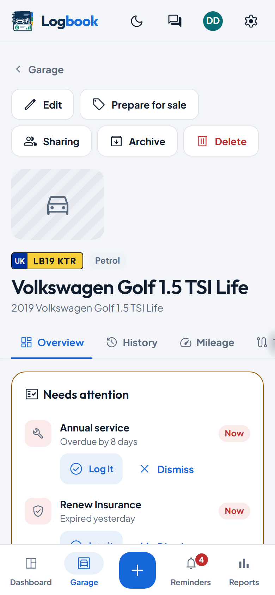
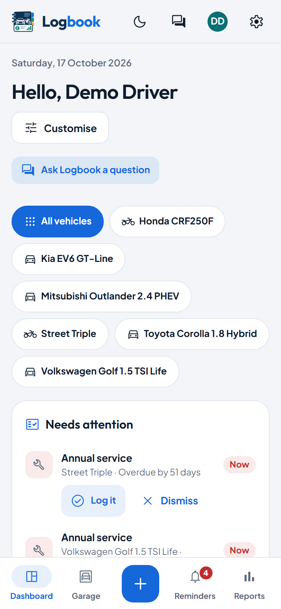

# Getting started

The first run after installing Logbook: the first admin, your preferences,
your first vehicle and fill-up, email, the household, modules and the first
backup.

**For:** whoever has just installed Logbook and opened it for the first time.
Installing it is in [deployment.md](deployment.md).

- [1. The first admin](#1-the-first-admin)
- [2. Your preferences](#2-your-preferences)
- [3. Your first vehicle](#3-your-first-vehicle)
- [4. The first fill-up and reading](#4-the-first-fill-up-and-reading)
- [5. Setting up email](#5-setting-up-email)
- [6. Inviting the household](#6-inviting-the-household)
- [7. Switching modules off](#7-switching-modules-off)
- [8. The first backup](#8-the-first-backup)
- [What next](#what-next)

## 1. The first admin

Open Logbook's address in a browser (`http://localhost:8080` for the Docker
quick start). An empty install shows the first-run setup page: a username and
a password (and, if you like, a display name), plus your language, time zone,
currency and units.
That account is the first **admin**: it can invite others and change the
install's settings. There is no default account and no password to change.

If the install allows the update check and you'd like to hear about new
versions, tick *Tell me when a new version is
out* on the same page. It is off unless you tick it
([deployment.md](deployment.md#update-check)).

## 2. Your preferences

Everything you chose on the setup page is yours alone, and each person who
joins later picks their own. Change them any time in **Settings → Profile**:

- **Units:** metric or imperial, and the economy unit (L/100 km, mpg UK or
  US, km/L). Logbook stores litres and kilometres and converts on screen, so
  switching never changes your figures.
- **Currency**, with a different one per vehicle if you need it.
- **Language and time zone.** Dates are shown in your time zone.

The theme follows your device unless you choose light or dark, there or with
the moon or sun at the top.

## 3. Your first vehicle

<picture>
  <source media="(prefers-color-scheme: dark)" srcset="images/vehicle-phone-dark.png">
  
</picture>

An empty garage offers **Set up your first vehicle**: five short steps, each
of which you can skip, leave and come back to.

1. **The vehicle:** the registration first. With [MOT history](mot-history.md)
   set up, *Look up* fills in the make, model, fuel and first registration;
   otherwise you type the make, model and fuel.
2. **Mileage now:** one number, dated today.
3. **Key dates:** the MOT, tax and insurance renewal dates. Each becomes a
   document with its expiry, and gets a reminder.
4. **Servicing:** a schedule, preset to every 12 months or 10,000 miles
   (16,000 km); check your handbook and change it if yours differs.
5. **Done:** links to log a fill-up, invite someone, or add the purchase
   price.

Until every step is done, a *getting-started* card on the vehicle's overview
shows how far you got, with the missing steps as links. Add more vehicles
from **Garage → Add vehicle**.

 

## 4. The first fill-up and reading

Press **Log entry** (on a phone, the **+** at the bottom) and choose
*Fill-up*. Fill in the odometer and any two of volume, price and total: the
third is worked out. Tick *Partial fill* when you didn't fill to the top.
Economy needs two full tanks, so the first fill-up shows none yet; that is
expected.

A mileage reading on its own (from the dashboard display, an MOT or a
service) goes in the same way, as *Odometer reading*. Readings and fill-ups
together make the mileage log that reminders and costs per mile use.

On a phone, add Logbook to your home screen to log fill-ups offline
([Installing on a phone](deployment.md#installing-on-a-phone-pwa)).

## 5. Setting up email

Email is off until an admin sets up the server, in **Settings → Delivery**:
the SMTP server, port, encryption, username and password, and the *From*
address. **Send test email** checks it. Email sends password-reset links,
invitations, reminders and the monthly digest.

Each person then chooses where their own reminders go in **Settings →
Account → Notifications**: email, or a channel such as ntfy, Gotify, Telegram, Discord,
Pushover, Mattermost, Slack or a webhook. Each channel has a test and quiet
hours. An admin decides in Settings → Delivery where members' channels may
send. The details are in
[notification-channels.md](notification-channels.md).

## 6. Inviting the household

In **Settings → Users**, an admin creates an invitation link for each person
and sends it to them. They choose their own username and password, and their
own units and language.

Each person starts with a garage of their own. To let someone see or log a
vehicle of yours, open the vehicle and choose **Sharing**: *View*, *Log* or
*Manage*, and whether they see its costs. The form says in plain words what
the share allows before you add it. More in
[users-and-sharing.md](users-and-sharing.md).

## 7. Switching modules off

<picture>
  <source media="(prefers-color-scheme: dark)" srcset="images/dashboard-phone-dark.png">
  
</picture>

New installs start with fuel, maintenance, documents, reminders and reports
on, and the AI features, which do nothing until an admin connects a model
([ai.md](ai.md)). **Settings → Modules** switches the others on (tyres,
trips, finance, incidents, issues, parts and fuel stations) and switches off
anything you don't use. Switching a module off hides it everywhere and
deletes nothing; switching it back on brings everything back.

The dashboard is yours to arrange: **Customise** adds, removes and reorders
widgets. A widget with nothing to show yet shrinks to one line in its
place; *Customise* shows it full size.

 

## 8. The first backup

**Settings → Backup and restore → Download backup** saves everything (every
vehicle, entry, setting and attached file) in one file. Keep it somewhere
other than the server. Restoring it on any install, on any database engine,
brings the whole garage back.

For a backup without remembering, set a daily or weekly schedule in
**Settings → Jobs**, or run `php bin/backup.php create` from cron. Settings → Backup says
how old the last backup is, and admins see a warning once it is older than
30 days (by default; you can change that, or turn it off). The details are in [deployment.md](deployment.md#backups).

## What next

- Bring your history across from a CSV file, Fuelio or Tracktor:
  [import.md](import.md), [import-tracktor.md](import-tracktor.md).
- See everything Logbook does: [features.md](features.md).
- Run it behind your reverse proxy: [reverse-proxies.md](reverse-proxies.md).

---

[Back to the docs index](README.md)
